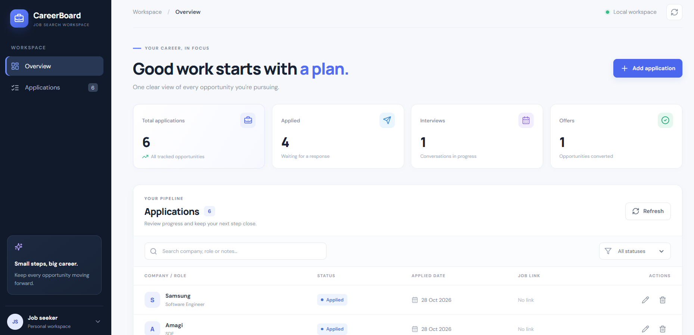
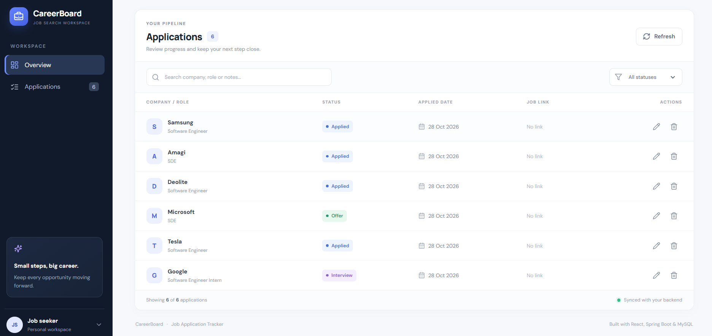

# CareerBoard — Job Application Tracker

CareerBoard is a full-stack web application designed to help job seekers organize and track their job applications in one place.

Instead of managing opportunities in spreadsheets, users can track their applications, monitor interview progress, and manage their job search through a modern dashboard.

## Features

- Dashboard with application statistics
- Add, view, edit, and delete job applications
- Track application statuses, including Applied, Interview, and Offer
- Search applications by company, role, or notes
- Filter applications by status
- Store job details, application dates, notes, and job links
- Input validation and API error handling
- Responsive user interface
- REST API for application management

## Tech Stack

**Frontend**
- React
- Vite
- JavaScript
- CSS
- Lucide icons

**Backend**
- Java 21
- Spring Boot
- Spring JDBC
- REST API
- Maven

**Database**
- MySQL

**Testing**
- JUnit
- Spring Boot Test
- Postman for API testing

## Project Architecture

```text
CareerBoard
|
|-- frontend/          React + Vite user interface
|
|-- src/main/java/     Spring Boot backend
|   |-- controller/    REST API endpoints
|   |-- service/       Application business logic
|   |-- repository/    Database operations
|   |-- model/         Application data model
|   |-- dto/           Request data validation
|
|-- src/main/resources/
|   |-- application.properties
|   |-- schema.sql
|
|-- pom.xml            Maven configuration
```

## Getting Started

### Prerequisites

Install the following:

- Java 21
- Node.js and npm
- MySQL Server
- Git

### 1. Clone the repository

```bash
git clone https://github.com/SujalPatil1616/CareerBoard.git
cd CareerBoard
```

### 2. Create the database

Open MySQL Workbench and execute:

```sql
CREATE DATABASE IF NOT EXISTS jobtracker;
```

### 3. Configure the database

The backend uses the following default database settings:

- Database: `jobtracker`
- Username: `root`
- Port: `3306`

Set the `MYSQL_PASSWORD` environment variable to your local MySQL password.

In Windows PowerShell:

```powershell
$env:MYSQL_PASSWORD = "YOUR_MYSQL_PASSWORD"
```

Replace the example value with your own password. Never publish your real database password on GitHub.

### 4. Start the backend

From the project root directory, run:

```powershell
.\mvnw.cmd spring-boot:run
```

The backend will run at:

`http://localhost:8080`

### 5. Start the frontend

Open a second terminal and run:

```powershell
cd frontend
npm install
npm run dev
```

Open the local URL shown in the terminal. It is usually:

`http://localhost:5173`

Keep both terminals running while using the application.

## API Endpoints

The backend exposes application-management endpoints under `/api/applications`.

| Method | Endpoint | Description |
|---|---|---|
| GET | `/api/applications` | Retrieve applications |
| POST | `/api/applications` | Create an application |
| PUT | `/api/applications/{id}` | Update an application |
| DELETE | `/api/applications/{id}` | Delete an application |

## Run Tests

From the project root, run:

```powershell
.\mvnw.cmd test
```

The automated backend tests help verify the application's behavior.


## Screenshots

### Dashboard — Overview



### Dashboard — Application Tracking




## Future Improvements

- User authentication and individual accounts
- Cloud deployment
- GitHub Actions continuous integration
- Interview reminders and follow-up notifications
- Advanced job-search analytics

## Author

**Sujal Patil**

GitHub: [@SujalPatil1616](https://github.com/SujalPatil1616)

---

Built as a full-stack portfolio project to practice frontend development, REST APIs, database integration, and software testing.
